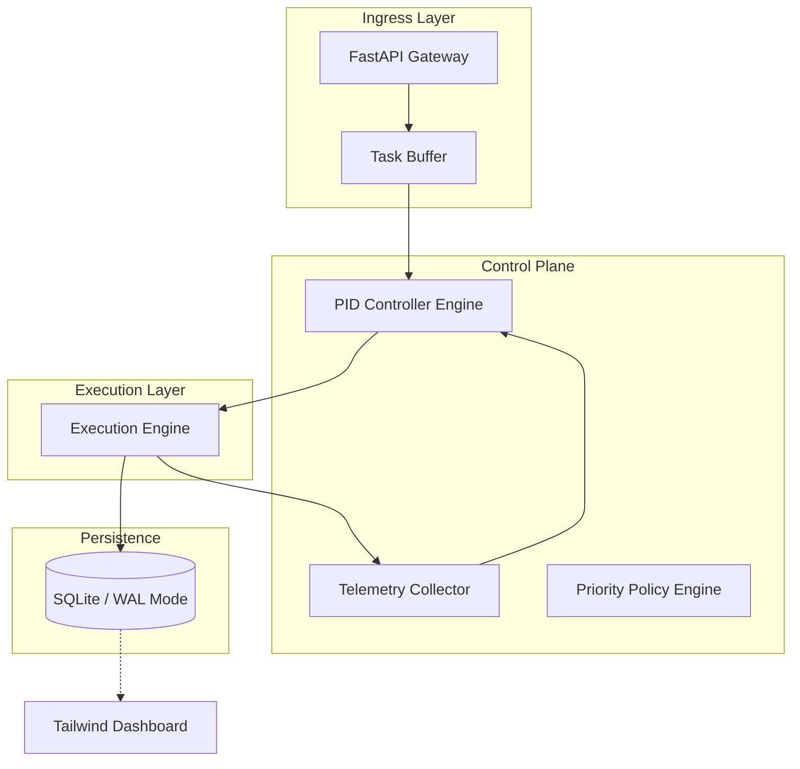

# ARCHITECTURE.md: Skill Latency Balancer (SLB)

## 1. High-Level System Topology
The SLB operates as a middleware orchestration layer between the Task Producer and the Execution Engine. It utilizes a PID (Proportional-Integral-Derivative) controller to modulate the `execution_permit` flow based on system telemetry.



## 2. Tech Stack Rationale
*   **Python 3.11+:** Utilizes `TaskGroup` and `asyncio` structured concurrency for non-blocking I/O.
*   **Pydantic v2:** Core schema validation using Rust-based parsing for high-throughput telemetry ingestion.
*   **FastAPI:** Asynchronous request handling with dependency injection for modular controller integration.
*   **SQLite (WAL Mode):** Chosen for atomic, ACID-compliant local state management with minimal overhead; WAL mode enables concurrent reads during high-frequency writes.
*   **PID Controller Algorithm:** Mathematical feedback loop to maintain target latency ($L_t$) by adjusting the throttle coefficient ($\alpha$).
*   **Tailwind CSS:** Utility-first styling for the dashboard to minimize DOM bloat and ensure sub-100ms render times.

## 3. Module & Directory Layout
```text
/slb
├── core/
│   ├── controller.py      # PID implementation logic
│   ├── scheduler.py       # Priority-based dispatching
│   └── telemetry.py       # Metric aggregation & windowing
├── api/
│   ├── endpoints.py       # FastAPI routes
│   └── schemas.py         # Pydantic v2 models
├── db/
│   ├── engine.py          # SQLite connection pooling
│   └── models.py          # SQLAlchemy/SQLModel definitions
├── dashboard/
│   ├── templates/         # Jinja2 + Tailwind
│   └── static/            # Compiled CSS/JS
├── workers/
│   └── executor.py        # Skill execution interface
└── main.py                # Application entry point
```

## 4. Data Flow & Component Interaction Pipeline
1.  **Ingestion:** Tasks are submitted via `POST /v1/tasks`. Pydantic validates payload schema and assigns an initial `priority_score`.
2.  **Telemetry Sampling:** The `TelemetryCollector` samples system load (CPU/Memory) and current `execution_latency` at 100ms intervals.
3.  **PID Calculation:** The `PIDController` computes the error term: $e(t) = L_{target} - L_{actual}$. The output $u(t)$ adjusts the `throttle_limit` (the number of concurrent tasks allowed).
4.  **Dispatch:** The `Scheduler` pulls tasks from the buffer, filtering by `priority_score` and the current `throttle_limit`.
5.  **Execution:** The `Executor` runs the task, updates the `TelemetryCollector` with completion time, and commits the result to SQLite.
6.  **Feedback:** The loop repeats, ensuring the system stabilizes around the $L_{target}$.

## 5. Security & Boundary Isolation
*   **Input Sanitization:** All task payloads are strictly validated against Pydantic models; unexpected fields are dropped (strict mode).
*   **Concurrency Isolation:** The `Execution Engine` runs tasks within isolated `asyncio.Task` contexts, preventing cross-task state leakage.
*   **Database Integrity:** SQLite is accessed via a thread-safe singleton pattern with `PRAGMA journal_mode=WAL` to prevent lock contention.
*   **Rate Limiting:** API endpoints are protected by a token-bucket rate limiter to prevent resource exhaustion from external ingress.
*   **Dependency Pinning:** All dependencies are locked via `requirements.txt` with hash verification to mitigate supply-chain injection.